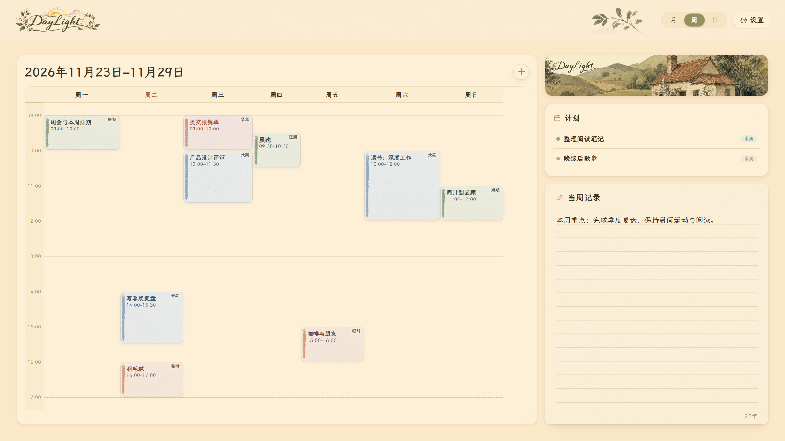
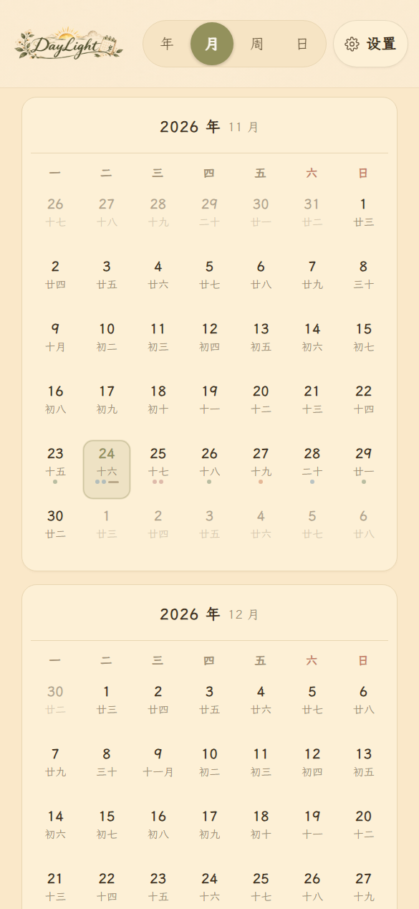

# DayLight · 零依赖的日程工具

 

零依赖、离线优先的个人日程工具：月 / 周 / 日 / 年视图，双击一个 HTML 文件就能用，数据只存在你自己的浏览器里。

A zero-dependency, offline-first day planner. Open one HTML file and go. Your data never leaves your browser.

  

**马上使用**：[在线体验](https://mingle180.github.io/DayPlan/) · [下载单文件版](https://github.com/Mingle180/DayPlan/releases/latest/download/DayPlan.html) · [下载桌面版](https://github.com/Mingle180/DayPlan/releases/latest/download/DayPlan-3.0.0-win-x64.zip)

## 为什么是它

- **零依赖**：纯 HTML / CSS / JavaScript，`file://` 下双击即开，无需服务器、无需构建、无需安装。
- **数据全本地**：事项默认只存浏览器 `localStorage`，随时可导出 / 导入 JSON 备份。
- **一个文件分享**：单文件版把全部样式与脚本内联，用微信 / QQ / 邮件发给别人，对方用浏览器打开就能用。

## 快速开始

### 在线体验

打开 <https://mingle180.github.io/DayPlan/>，无需注册。

### 下载即用

- **单文件版**：[DayPlan.html](https://github.com/Mingle180/DayPlan/releases/latest/download/DayPlan.html)。下载后双击，用浏览器打开即用。
- **桌面版**：[DayPlan-3.0.0-win-x64.zip](https://github.com/Mingle180/DayPlan/releases/latest/download/DayPlan-3.0.0-win-x64.zip)。解压后运行 `Start DayPlan.cmd` 或 `DayPlan.exe`。
  - 若 Windows 智能应用控制拦截未签名程序：双击同目录的 `DayPlan-Browser.html`（同一套代码，用浏览器打开），或按 `FIRST-RUN-README.zh-CN.txt` 的说明关闭 SAC。

### 从源码运行

公开快照就是运行所需的全部文件：下载仓库后直接打开 `index.html`。测试、构建脚本与开发规范不在公开快照内。

## 功能一览

| 模块 | 说明 |
|---|---|
| 视图 | 月 / 周 / 日 / 年（手机），月视图连续多月滚动 |
| 时间轴 | 日视图横向、周视图纵向；首末空闲时段折叠；按类别分道 |
| 事项 | 单击展开，右键标记完成，拖拽排序；支持备注与提醒 |
| 周计划 | 在周视图创建，拖到某天生成独立副本 |
| 重复 | 每天 / 每周 / 每月 / 每年（公历 / 农历）；可排除法定节假日 |
| 节假日 | 2008–2027 中国大陆放假与调休标注 |
| 记录 | 今日记录与当周记录 |
| 倒计时 | 右栏倒计时，按剩余时间排序 |
| 数据 | JSON 导出 / 导入；登录后可手动保存到云端，云端保留最近 5 版 |
| 外观 | 明暗主题、霞鹜文楷字体、纸感插画 |

更细的操作说明见 [交互式使用教程](docs/tutorial/tutorial-single.html)。

## 数据与隐私

- 不登录时，数据只写本机浏览器，无账号、无遥测。
- 可选登录云端（Supabase）手动保存：点「保存」覆盖云端并同步到其他设备，云端保留最近 5 个版本。
- 换设备或换来源（`file://` / Pages / 桌面版）时，用「设置 → 数据 → 导出 / 导入 JSON 备份」迁移。

## 已知边界

- 节假日数据覆盖 2008–2027，2028 年起不做推算。
- 农历覆盖 1901–2100。
- 不支持跨日事项（结束时间必须晚于开始时间）。

## 许可证

本项目以 MIT 授权，完整条款见 [LICENSE](LICENSE)。

Copyright (c) 2026 Mingle180。

第三方字体（霞鹜文楷、Rouge Script）遵循各自的 OFL 许可，见 [assets/fonts/](assets/fonts/)。